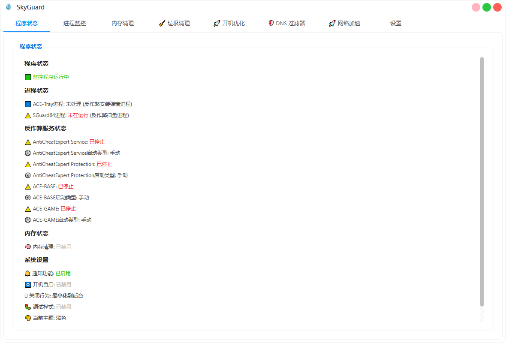
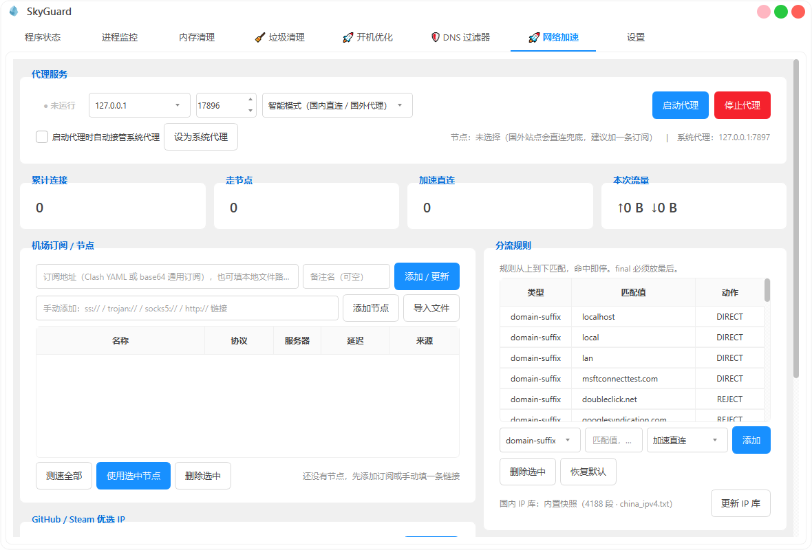
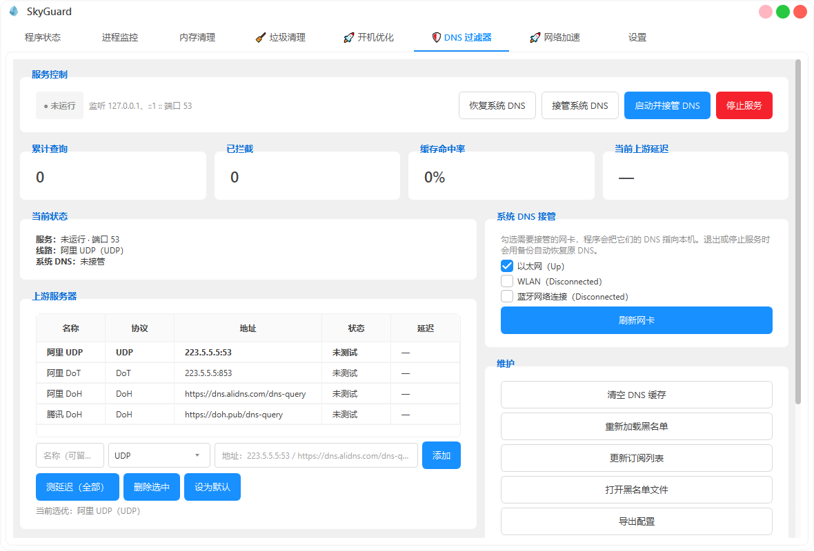
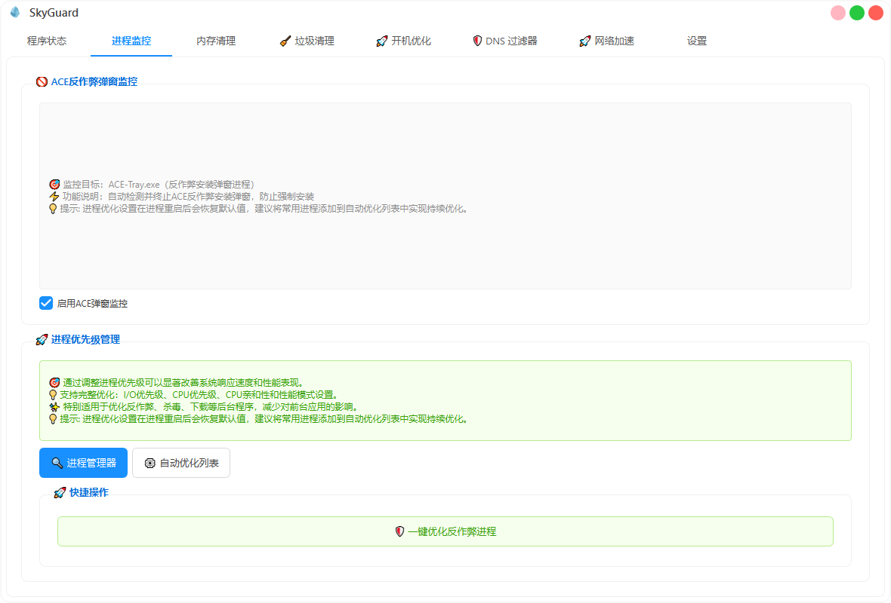
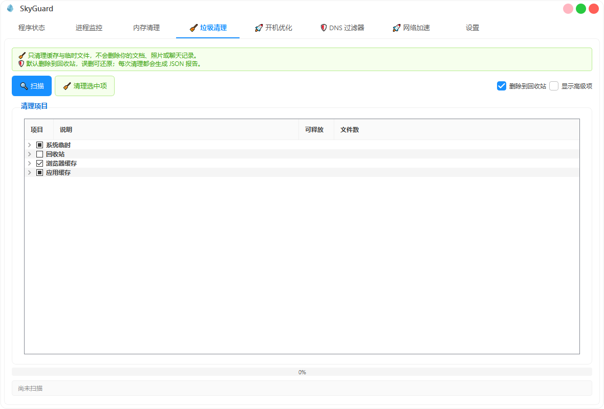
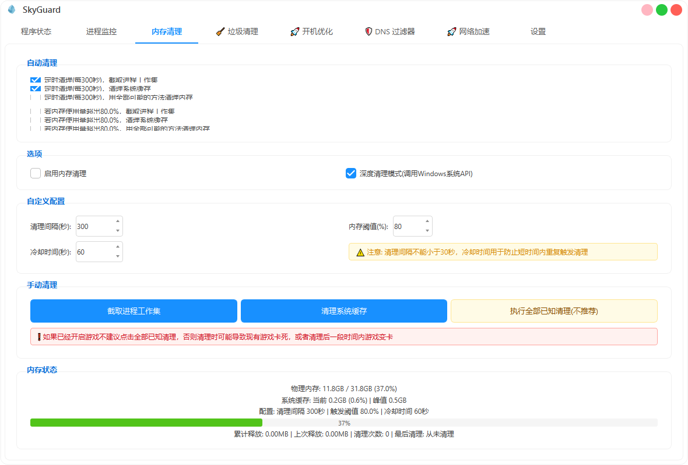
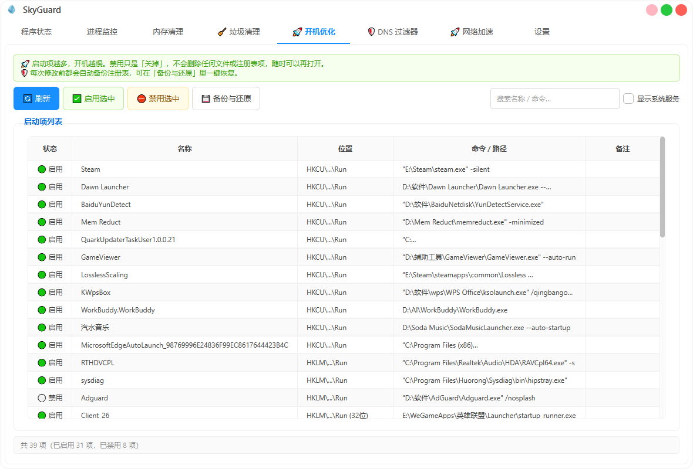
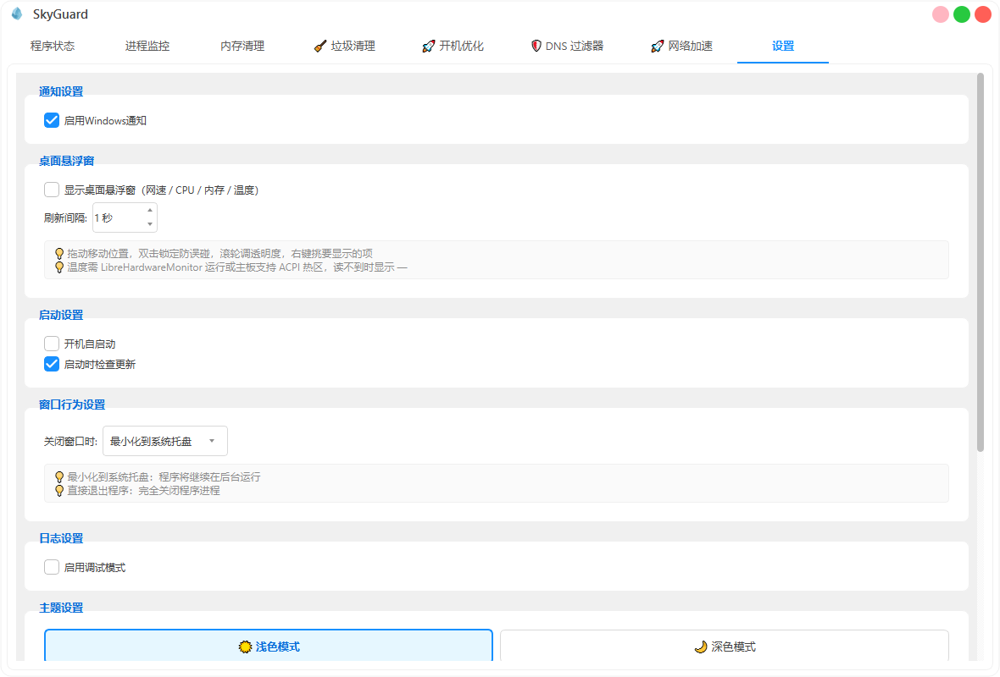

# 🛡️ SkyGuard · 天幕进程优化工具

以游戏反作弊进程管理为核心，集内存清理、垃圾清理、开机优化、DNS 广告过滤与 GitHub / Steam 网络加速于一体的 Windows 系统工具箱。

    
    
    
    

> ## ⚠️ 重要声明
> 🚨 本项目所有代码均通过**标准Windows API和脚本实现**
> 🔒 不涉及**任何反作弊内核修改、注入或破解**，仅对进程资源进行合理管理
> ⚖️ 所有功能基于Windows系统标准权限管理，**未使用任何第三方破解工具**
> 🎯 本项目仅优化系统资源分配，**不干扰反作弊程序的正常检测逻辑，所有操作均合理合法**
> ❗ 如果您因使用本工具而遇到任何被检测的问题，请**优先检查自己网络环境是否异常，本地是否使用了其他可能导致封号的软件**
> ⚠ **本项目相关issue将不再受理任何被封禁或检测问题的反馈，使用前请自行评估风险**

## ✅ 功能特性
- 🛡️ 自动关闭`ACE-Tray.exe`反作弊安装询问弹窗
- 🚀 自动优化`SGuard64.exe`扫盘进程，降低 CPU 占用
- 🗑️ 支持一键启动/停止反作弊进程，卸载/删除 ACE 反作弊服务
- 🐻 支持自定义进程性能模式
- 🧹 内置内存清理（重构自 `H3d9` 的 [Memory Cleaner](https://github.com/H3d9/memory_cleaner)）
- 🧽 **垃圾清理**：17 类目标（系统临时 / 浏览器缓存 / 回收站 / 应用缓存 / 系统组件），先扫描预览再清理，默认送回收站；另附 **全盘空间分析**（磁盘占用、系统残留、开发缓存、大文件、重复文件），只读扫描、不擅自删除
- 🚀 **开机优化**：注册表 Run、启动文件夹、计划任务、系统服务四类启动项统一管理，禁用不改注册表本体、可逆，改动前自动备份；内置 **启动项建议引擎**，逐项给出「建议关闭 / 可选 / 建议保留」+ 理由与关停影响
- 📱 支持 Windows 系统通知
- 🪟 **桌面悬浮窗**：常驻小窗显示实时上下行网速、CPU / 内存占用与温度，可拖动、双击锁定、滚轮调透明度，右键自选显示项
- 🛡 **DNS 过滤器**：内置本地 DNS 服务器（端口 53），上游支持 UDP / DoH / DoT，广告域名拦截返回黑洞地址，可一键接管系统 DNS（自动备份、退出自动恢复）
- 🚀 **网络加速**：GitHub / Steam 优选 IP（多出口 DoH 抓取 + TCP 实测延迟，可写入 hosts）；本地混合代理（HTTP + SOCKS5 同端口，类似 Clash），支持添加机场订阅（Clash YAML / base64 通用订阅）与手动节点，规则分流（加速直连 / 代理 / 拦截），一键接管系统代理
- 🔄 支持开机静默自启
- 💻 系统托盘常驻运行
- 🌓 支持明暗主题切换

## 🪟 桌面悬浮窗

网速、温度这类数字是「余光扫一眼」的需求，为此点开主窗口并不划算。托盘右键勾选 **桌面悬浮窗（网速/温度）** 即可常驻显示：

| 操作 | 效果 |
| :--- | :--- |
| 左键拖动 | 移动位置，松手即记忆，下次启动原地出现 |
| 双击 | 锁定 / 解锁位置，避免误碰 |
| 滚轮 | 不透明度 60% → 100% 五档调节 |
| 右键 | 勾选显示项（下载 / 上传 / CPU / 内存 / 温度）、不透明度、锁定、隐藏 |

**关于温度**：Windows 没有统一的 CPU 温度接口，`psutil` 在 Windows 上也不提供传感器读数。程序按可靠性依次尝试三个数据源，读不到就显示 `—`，不会用 CPU 占用率冒充温度：

1. **LibreHardwareMonitor / OpenHardwareMonitor**（WMI 传感器）——能同时拿到 CPU 与 GPU 温度，最可靠，需本机装有并正在运行；
2. **ACPI 热区**（系统自带）——部分笔记本可用，台式机多数主板不上报；
3. 都不可用时显示 `—`，鼠标悬停该行会说明原因。

采集在独立线程中进行，温度查询带缓存与退避（WMI 单次 100~500 ms，每秒硬查会拖慢窗口拖动）。刷新间隔可在设置页调为 1~5 秒。

## 🛡 DNS 过滤器

程序内置一个真实可用的本地 DNS 服务器（`core/dns_filter.py`，纯 Python 实现，无额外依赖）：

| 能力 | 说明 |
| :--- | :--- |
| 监听 | UDP + TCP，默认端口 53，同时监听 `127.0.0.1` 与 `::1`，可选开放局域网（`0.0.0.0`） |
| 上游 | UDP / DoH / DoT 三种协议可混合添加，支持一键测延迟、设默认；默认上游失败自动按列表顺序切换 |
| 拦截 | 黑名单（精确 + 子域匹配），A 记录返回 `0.0.0.0`、AAAA 返回 `::`、其余类型返回 NXDOMAIN（可在配置中切换为全部 NXDOMAIN） |
| 缓存 | 按 TTL 过期，命中后逐条递减 TTL 回写，统计命中率 |
| 接管 | 勾选网卡后把系统 DNS 改指本机，原 DNS 备份到 `%USERPROFILE%\.skyguard\dns_backup.json`；停止服务或退出程序时自动恢复 |
| 黑名单 | 首次启动生成兜底名单；支持「更新订阅」（anti-AD hosts 格式）；可直接编辑 `%USERPROFILE%\.skyguard\dns-blocklist.txt` |

查询统计（累计查询 / 已拦截 / 缓存命中率 / 上游延迟）与最近拦截记录在页面实时刷新。

## 🚀 网络加速（GitHub / Steam）

内置一套真实可用的加速方案，由「优选 IP」和「本地代理」两部分组成：

### 优选 IP

用多个公共 DoH 出口（阿里 / 腾讯 / Cloudflare / Google）解析同一批域名，不同出口会拿到不同的 CDN 边缘节点，再对候选 IP 逐个做 443 端口 TCP 握手测速，按延迟取最快的几个。支持：

- 一键测速 GitHub（20 个域名）与 Steam（16 个域名）两组内置清单，也可填自己的域名；
- 结果写入本地缓存（`%USERPROFILE%\.skyguard\ip_cache.json`），代理的「加速直连」规则实时复用；
- 可一键写入 hosts（自动备份原文件、只写 SkyGuard 自己的段落、随时还原），写完自动刷新 DNS 缓存。

### 本地混合代理

与 Clash 的 mixed port 用法一致，浏览器 / 系统代理填 `127.0.0.1:7890` 即可：

| 能力 | 说明 |
| :--- | :--- |
| 入口 | HTTP 代理（CONNECT 隧道 + 普通 http 转发）与 SOCKS5 共用同一端口 |
| 内核 | 页面可切换：**内置引擎**（Shadowsocks AEAD、Trojan、HTTP、SOCKS5）或 **Clash 内核 mihomo**（hysteria2 / vless / vmess 等全部协议，自动复用本机 Clash Verge 自带内核，也支持一键从 GitHub 下载官方内核） |
| 订阅 | 内置引擎解析 Clash YAML 与 base64 通用订阅；mihomo 内核模式下订阅直接交给内核拉取与定时更新 |
| 模式 | 智能模式（默认，国内直连 / 国外走代理）、仅按规则、全局代理、全部直连 |
| 规则 | domain-suffix / domain / keyword / regex / ip-cidr / final，动作支持加速直连、直连、走节点、拒绝，页面可视化增删 |
| 接管 | 可自动把系统代理指向本机（备份原值，退出自动还原），本机与内网地址在任何模式下都强制直连 |
| 监控 | 累计连接 / 走节点 / 加速直连 / 流量统计与最近连接列表实时刷新 |

### 智能分流（国内直连 / 国外走代理）

默认的「智能模式」按下面顺序判断，绝大多数请求不查库、不走 DNS：

1. 本机与内网地址 → 直连；
2. 内置国内域名后缀表（约 200 条常用站点）→ 直连；
3. GitHub / Steam 命中加速规则 → 优选 IP 直连；
4. 都没命中时解析域名，落在国内 IPv4 段（内置 APNIC 快照，约 4200 条 CIDR，仅 65KB，支持一键「更新 IP 库」）→ 直连；
5. 解析失败或超时 → 走代理（被墙域名本地 DNS 往往直接失败，交给节点出口解析反而更容易通）。

没配置节点时国外站点会直连兜底，页面会提示先添加订阅；IP 判定结果带 10 分钟缓存，不会每条连接都去解析。

内核模式下节点测速 / 切换 / 流量与连接监控都通过 mihomo 的 RESTful API 完成；DNS 过滤器运行中时，内核 DNS 解析会自动走本机 53 端口，代理流量同样经过广告过滤。

测速延迟来自节点对 `www.gstatic.com:80` 的真实握手耗时；本机与内网地址任何模式下都直连。

## 🧽 垃圾清理与开机优化

### 垃圾清理

| 分组 | 内容 | 默认勾选 |
| :--- | :--- | :--- |
| 系统临时 | 用户/系统临时文件、IE 缓存、缩略图缓存、Prefetch、错误报告 | 部分（Prefetch/WER 需手选） |
| 回收站 | 清空回收站 | 否 |
| 浏览器缓存 | Chrome / Edge / Firefox 缓存（不含 Cookie、密码、书签） | 是 |
| 应用缓存 | 微信 / QQ / 网易云音乐 / 钉钉 / 企业微信 | 否 |
| 系统组件（高级） | Windows 更新缓存、传递优化缓存、CBS 日志、WinSxS 组件清理 | 隐藏，需勾「显示高级项」 |

安全机制：先扫描后清理、删除默认走回收站、保护名单（系统目录 / 盘根 / 用户目录根部）硬拦截、符号链接不跟随、每次清理生成 JSON 报告（`%USERPROFILE%\.skyguard\reports\`）。

#### 全盘空间分析（只读）

第二个页签解决「空间到底被谁吃了」，全程只读，不会自己删任何东西：

| 分组 | 内容 |
| :--- | :--- |
| 磁盘占用 | 各固定磁盘容量条（网络盘 / 可移动盘默认跳过） |
| 系统可清理 | 回收站、Windows.old、休眠文件、内存转储、系统还原点、系统日志 |
| 应用缓存 / 开发缓存 | 临时文件、浏览器缓存、pip / npm / pnpm / Gradle / WSL 虚拟磁盘等 |
| 安装包残留 | 下载目录里体积偏大的安装包 |
| 深度模式 | 200MB 以上大文件 Top 60、重复文件（大小 → 头部 → 全文哈希比对）、2 年未动的文件 |

能对应到清理规则的项目支持一键送回收站（可还原）；回收站属于**不可恢复**操作，单独标注、不进一键清理，需到「规则清理」页手动确认。

### 开机优化

- 统一列出 **注册表 Run/RunOnce、启动文件夹、计划任务、系统服务** 四类启动项
- 启停与任务管理器同机制（写 `StartupApproved`），**不删除任何启动项本体**，随时可恢复
- 禁用前自动备份（`%USERPROFILE%\.skyguard\backup\`，含 JSON 快照 + 可读 .reg），支持一键还原
- 系统服务仅展示不建议改动，避免误关导致系统异常
- **启动项建议**：每项给出三档结论（🟠 建议关闭 / ⚪ 可选 / 🟢 建议保留）、理由、关停影响与启动耗时估算；安全软件、输入法、`\Microsoft\` 系统任务强制保留；支持「只看建议关闭」与「一键关闭建议项」（先备份，可还原）

## 🚀 如何使用

1. [前往 Releases 下载最新版 zip 压缩包](https://github.com/xiaolei7172/SkyGuard/releases) 👈
2. 解压后运行 `SkyGuard.exe`
3. 程序将在系统托盘显示图标
4. 右键点击托盘图标可以：
   - 👁️ 查看程序状态
   - 🔔 启用/禁用 Windows 通知
   - 🔄 设置开机自启动
   - ⚙️ 配置游戏监控
   - 📁 打开配置目录
   - 🚪 退出程序

## 🏠 项目展示

| 程序状态 | 🚀 网络加速 |
| :---: | :---: |
|  |  |

| 🛡 DNS 过滤器 | 进程监控 |
| :---: | :---: |
|  |  |

| 🧹 垃圾清理 | 内存清理 |
| :---: | :---: |
|  |  |

| 🚀 开机优化 | 设置 |
| :---: | :---: |
|  |  |

## 😶‍🌫️ 进程模式策略

| 性能模式    | CPU 优先级             | 效能节流     | CPU 核心绑定   |
| ----------- | ---------------------- | ------------ | ------------ |
| 🌱 效能模式 | 低优先级(IDLE)         | 启用节流     | 最后一个核心 |
| 🍉 正常模式 | **正常优先级(NORMAL)** | **禁用节流** | 所有核心     |
| 🚀 高性能   | 高优先级(HIGH)         | 禁用节流     | 所有核心     |
| 🔥 最大性能 | 实时优先级(REALTIME)   | 禁用节流     | 所有核心     |

## ⚙️ ACE Services 说明

- **AntiCheatExpert Service**：用户模式，由 `SGuard64.exe` 控制的游戏交互的服务，也是在服务概览 (services.msc) 中看到的唯一服务
- **AntiCheatExpert Protection**：反作弊组件
- **ACE-BASE**：内核模式，加载系统驱动程序
- **ACE-GAME**：内核模式，加载系统驱动程序

## ⚠️ 注意事项

- *本项目有系统提权的代码可能导致Windows安全中心误报，建议将程序文件夹添加至排除项(病毒威胁防护设置-管理设置-添加排除项)
- ***杀毒软件误报说明**：程序需要管理员权限运行（`requireAdministrator`），且包含进程管理、DNS / 系统代理接管等系统能力，加之发布包未做代码签名，部分杀毒软件（如 360、火绒、Defender）可能将其启发式判定为 `Backdoor/W64.Agent` 一类风险并拦截。本程序源码全部开放，请认准官方 Release 页下载并核对 `.sha256` 校验值；被误删时可在杀软隔离区恢复，或将解压目录加入信任区。如遇误报，欢迎通过 360 误报平台（open.soft.360.cn）等渠道反馈样本
- *本程序需要管理员权限运行
- *使用过程中如遇到问题，日志文件位于 `%USERPROFILE%\.skyguard\logs\` 目录
- *从旧版 ACE-KILLER 升级的用户请注意：本分支配置目录为 `.skyguard`，与旧版 `.ace-killer` 互不影响，需重新配置一次

## 📢 免责声明

- **本项目仅供个人学习和研究使用，禁止用于任何商业或非法目的。**
- **使用者在使用本项目时，必须严格遵守 `中华人民共和国（含台湾省）` 以及使用者所在地区的法律法规。禁止将本项目用于任何违反相关法律法规的活动。**
- **使用者应自行承担因使用本项目所产生的任何风险和责任。开发者不对因使用本项目而导致的任何直接或间接损失承担责任。**
- **若使用者发现任何商家或第三方以本项目进行收费或从事其他商业行为，所产生的任何问题或后果与本项目及开发者无关。使用者应自行承担相关风险。**

## 📜 许可证与致谢

- **本项目采用 `GNU General Public License v3.0`** - 详见 [LICENSE](LICENSE) 文件
- 🙌 本项目基于 [Cassianvale/ACE-KILLER](https://github.com/Cassianvale/ACE-KILLER)（GPL-3.0）二次开发，感谢原作者 [CassianVale](https://github.com/Cassianvale) 与 [Tomatocicier](https://github.com/Tomatocicier) 的贡献。原项目已无限期停更，本仓库在其基础上以 SkyGuard 之名继续维护
